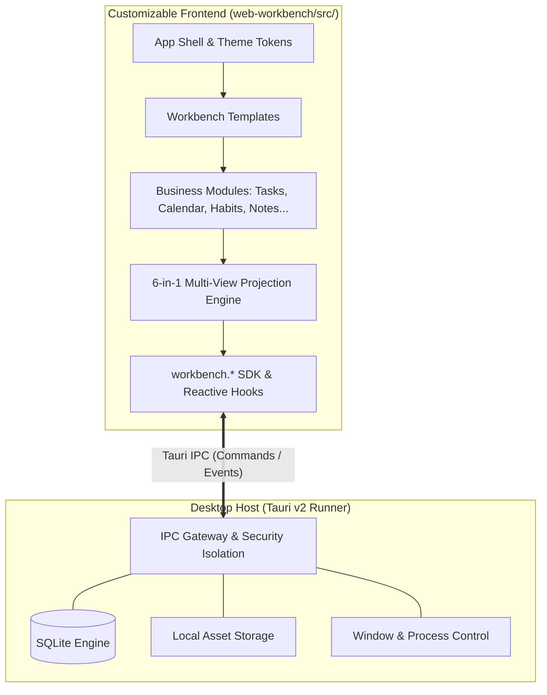

# OM Workbench

<p align="center">
  <strong>A local-first, agent-customizable personal desktop workbench.</strong><br>
  <em>"UI is disposable, data is an asset."</em>
</p>

<p align="center">
  <a href="LICENSE"></a>
  <a href="https://nodejs.org/"></a>
  <a href="https://react.dev/"></a>
  <a href="https://www.typescriptlang.org/"></a>
  <a href="https://tauri.app/"></a>
  <a href="https://vite.dev/"></a>
</p>

<p align="center">
  <b>English</b> | <a href="README.zh-CN.md">简体中文</a>
</p>

---

## Overview

**OM Workbench** is a local-first personal productivity workbench built on a decoupled two-tier architecture: a **native desktop runner** powered by Tauri 2 and SQLite, paired with an **editable frontend workspace** built with React 19, TypeScript, and Vite.

Unlike conventional productivity tools with rigid workflows or cloud web apps with fragile browser caches, OM Workbench separates UI logic from physical data storage:
- **Your Data Remains Permanent**: Managed locally in SQLite with physical transactions, local media hosting, and versioned backups.
- **Your UI Can Evolve Continuously**: Front-end code lives in plain source on your disk. Your AI coding assistants (Claude Code, Cursor, Windsurf, etc.) can refactor, rewrite, and generate new business modules anytime without touching the Rust desktop runner.

---

## Architecture at a Glance



### Core Highlights

- 🔒 **Local-First & Offline-Ready**: Full SQLite persistence on your filesystem. Zero required cloud dependencies, offline fonts, and zero external tracking.
- 🤖 **Agent-First Workflow**: Pre-configured guidelines and contracts (`AGENTS.md`) enable local AI agents to safely add features, tweak views, and build custom modules.
- 📊 **6-in-1 Multi-View Engine**: Single source of truth projected into List, Kanban, Calendar, Matrix (Eisenhower), Table, and Card views with synchronized state.
- ⚡ **Instant Live Preview**: Incremental Vite builds with watch mode trigger real-time desktop window hot reloads.
- 🎨 **Adaptive Shell**: Fully responsive layout using `@container` queries for fluid adaptation between narrow sidebar and wide canvas modes.

---

## Quick Start

### Prerequisites

- **OS**: Windows 10/11 (with WebView2) / macOS / Linux
- **Runtime**: [Node.js](https://nodejs.org/) (`>= 22.12`) & `npm`

### Installation

```bash
# Clone the repository and install root dependencies
npm install
```

### Development & Preview

```bash
# 1. Front-end standalone preview (Vite dev server at http://localhost:5173)
npm run dev

# 2. Watch mode (incrementally builds web-workbench/dist/ and triggers desktop hot reload)
npm run build:watch

# 3. Launch desktop host with live frontend (requires Rust toolchain if building host from source)
npm run host:dev
```

### Quality Assurance

```bash
# Run type checks, ESLint, and Prettier formatting checks
npm run check

# Run automated unit and integration tests (Vitest)
npm run test

# Build offline static assets
npm run build
```

---

## Documentation Hub

Comprehensive architectural, development, and API guides are included in the repository:

| Document | Description |
| :--- | :--- |
| 🧭 **[Frontend Guide & Agent Navigation](web-workbench/docs/README.md)** | Overall frontend architecture, step-by-step development sequence, and task index. |
| 📐 **[Runtime & Development Conventions](web-workbench/docs/shared/workbench-runtime-and-conventions.md)** | Zero-CDN rule, single-source-of-truth paradigm, theme tokens, and container query conventions. |
| 🔌 **[Host Capabilities & SDK Interfaces](web-workbench/docs/modules/host-and-sdk-interfaces.md)** | `workbench.records`, `workbench.assets`, window controls, and React hooks (`useRecords`, `useAction`). |
| 🧩 **[Reusable UI & Multi-View Engine](web-workbench/docs/modules/reusable-ui-and-views.md)** | UI primitives, multi-view container, headless table, calendar integration, and charts. |
| 🏗️ **[Custom Modules & Templates](web-workbench/docs/modules/custom-modules-and-templates.md)** | 3-tier decoupling pattern, template assembly, and 12-domain feature expansion recipes. |
| 🖼️ **[Content Layout Specifications](web-workbench/docs/content-layout.md)** | App shell sizing, window borders, scroll container setup, and visual regression guidelines. |
| 🏛️ **[System Architecture & Tech Decisions](dev-doc/README.md)** | Tauri host architecture, IPC protocols, database schemas, and design rationales. |
| 💡 **[Product Deck & Philosophy](product-deck.md)** | Slides introducing the core philosophy: *"UI is disposable, data is an asset"*. |

---

## Repository Structure

```text
.
├── web-workbench/            # Frontend application (React 19 + TypeScript + Vite)
│   ├── src/                  # Primary workspace for developers and AI agents
│   │   ├── modules/          # Business domains (Todos, Habits, Notes, Calendar, etc.)
│   │   ├── templates/        # Composable workspace templates
│   │   ├── ui/               # Primitives, 6-in-1 multi-view container, tables, charts
│   │   └── sdk/              # Type-safe workbench SDK and reactive hooks
│   └── docs/                 # Detailed frontend development documentation
├── tauri-host/               # Native desktop host (Tauri v2 + SQLite + Rust)
├── dev-doc/                  # Complete system architecture specifications & IPC contracts
├── scripts/                  # Packaging and distribution automation
├── AGENTS.md                 # Rules and guidelines for AI coding assistants
└── product-deck.md           # Product positioning and conceptual slides
```

---

## License

This project is licensed under the [MIT License](LICENSE).
