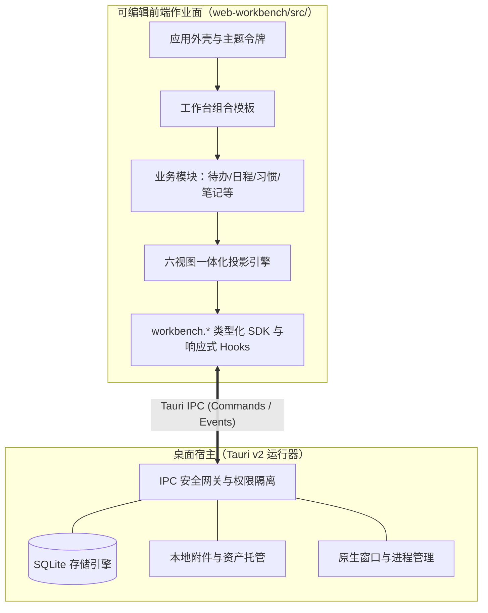

# OM Workbench 个人自定义工作台

<p align="center">
  <strong>一款装在你电脑上、由 AI 助手协同改造的本地优先个人工作台。</strong><br>
  <em>“界面是消耗品，数据是资产。”</em>
</p>

<p align="center">
  <a href="LICENSE"></a>
  <a href="https://nodejs.org/"></a>
  <a href="https://react.dev/"></a>
  <a href="https://www.typescriptlang.org/"></a>
  <a href="https://tauri.app/"></a>
  <a href="https://vite.dev/"></a>
</p>

<p align="center">
  <a href="README.md">English</a> | <b>简体中文</b>
</p>

---

## 项目概览

**OM Workbench** 是一套采用双层解耦交付架构的本地优先个人工作台：底层是由 Tauri 2 与 SQLite 驱动的**固定桌面宿主运行器**，上层是由 React 19、TypeScript 与 Vite 构建的**完全可编辑的前端工作台**。

区别于传统效率软件僵化的流程，或基于公网网页工作台脆弱的浏览器缓存，OM Workbench 将 UI 展示层与底层数据资产进行彻底物理隔离：
- **数据始终是你的资产**：原生 SQLite 存储、物理事务、本地附件管理以及版本化备份恢复，数据 100% 留在你的硬盘中。
- **界面可以随时按需重塑**：前端源码以清晰易懂的形式保存在你的工作区中。你的本地 AI 编码助手（如 Claude Code、Cursor、Windsurf 等）可以随时随地重构视图、调整配色、新增专属业务模块，而无需安装 Rust 工具链或重新编译桌面宿主。

---

## 架构拓扑一览



### 核心亮点

- 🔒 **本地优先与纯离线**：数据落盘于本地 SQLite，附件物理隔离托管；内置离线字体与图标，零公网依赖与外链泄露风险。
- 🤖 **Agent 友好架构**：配备严格的二次开发约束与 Agent 须知（[`AGENTS.md`](AGENTS.md)），AI 助手可端到端独立完成功能交付与安全验证。
- 📊 **六视图一体化引擎**：单一事实源（Single Source of Truth）自动投影至列表、看板、日历、四象限、表格与卡片视图，状态多端同步。
- ⚡ **即时热刷新体验**：Vite 增量监听构建（`build:watch`），代码保存后桌面窗口毫秒级即时热刷新。
- 🎨 **双形态自适应外壳**：基于 CSS `@container` 容器查询，实现窄侧栏流式视图与宽画布多列看板的无缝自适应切换。

---

## 快速上手

### 环境要求

- **操作系统**：Windows 10/11（内置 WebView2）/ macOS / Linux
- **开发环境**：[Node.js](https://nodejs.org/) (`>= 22.12`) 与 `npm`

### 安装依赖

```bash
# 克隆代码仓库并安装根目录依赖
npm install
```

### 启动开发与预览

```bash
# 1. 前端独立预览（启动 Vite 开发服务器，端口 5173）
npm run dev

# 2. 增量监听构建（监听 web-workbench/src/ 变更，驱动桌面宿主热刷新）
npm run build:watch

# 3. 完整启动 Tauri 桌面宿主窗口（源码模式下需本机具备 Rust 环境）
npm run host:dev
```

### 质量保证与测试

```bash
# 运行类型检查、ESLint 与 Prettier 代码格式检查
npm run check

# 执行 Vitest 前端单元与集成测试
npm run test

# 执行单次离线静态产物全量构建
npm run build
```

---

## 完整文档中心

本项目已内置完备的架构规范、SDK 契约与二次开发指南，欢迎查阅以下专题文档：

| 专题文档 | 内容说明 |
| :--- | :--- |
| 🧭 **[前端开发指南总览与 Agent 导航](web-workbench/docs/README.md)** | 前端工程完整架构、模块关系拓扑、开发依赖顺序与任务查阅索引。 |
| 📐 **[运行时与开发公共规范](web-workbench/docs/shared/workbench-runtime-and-conventions.md)** | 离线零外链底线、单一事实源范式、响应式单向数据流与主题设计令牌。 |
| 🔌 **[宿主开放能力与前端 SDK 契约](web-workbench/docs/modules/host-and-sdk-interfaces.md)** | `workbench.records` 通用数据层、`workbench.assets` 资产层及 React Hooks 详解。 |
| 🧩 **[前端可复用控件与多视图引擎](web-workbench/docs/modules/reusable-ui-and-views.md)** | 基础交互原语、六视图容器、无头表格、全功能日历与统计图表集成。 |
| 🏗️ **[业务模块组装与模板扩展](web-workbench/docs/modules/custom-modules-and-templates.md)** | 参考模块三层解耦结构、工作台模板注册切换与 12 大业务域扩展模式。 |
| 🖼️ **[工作台内容布局规范](web-workbench/docs/content-layout.md)** | 应用外壳直角铺满、容器滚动区域分配与外观回归验收基准。 |
| 🏛️ **[系统架构与技术选型决策](dev-doc/README.md)** | Tauri 宿主技术架构、IPC 通信协议、安全隔离机制与数据库设计。 |
| 💡 **[产品定位与设计幻灯片](product-deck.md)** | 深入阐述“界面是消耗品，数据是资产”产品哲学的核心幻灯片。 |

---

## 目录结构一览

```text
.
├── web-workbench/            # 前端工程与二开主要作业面（React 19 + TypeScript + Vite）
│   ├── src/                  # 核心源码目录（业务模块、组件、SDK、样式与模板）
│   │   ├── modules/          # 业务功能模块（待办、习惯、记账、笔记、日程等）
│   │   ├── templates/        # 模块化工作台组合模板
│   │   ├── ui/               # 交互基础控件、六视图一体化容器、表格与图表
│   │   └── sdk/              # 类型化 workbench SDK 与响应式 Hooks
│   └── docs/                 # 完整的前端开发指南文档集
├── tauri-host/               # 桌面宿主原生代码（Tauri v2 + SQLite + Rust）
├── dev-doc/                  # 顶层系统架构设计与跨端 IPC 通信契约文档
├── scripts/                  # 工程自动化与 DevKit 二次开发套件打包脚本
├── AGENTS.md                 # 供 AI 辅助编程读取的规范指导文件
└── product-deck.md           # 产品哲学与特性介绍文档
```

---

## 开源许可证

本项目基于 [MIT 许可证](LICENSE) 开源。
