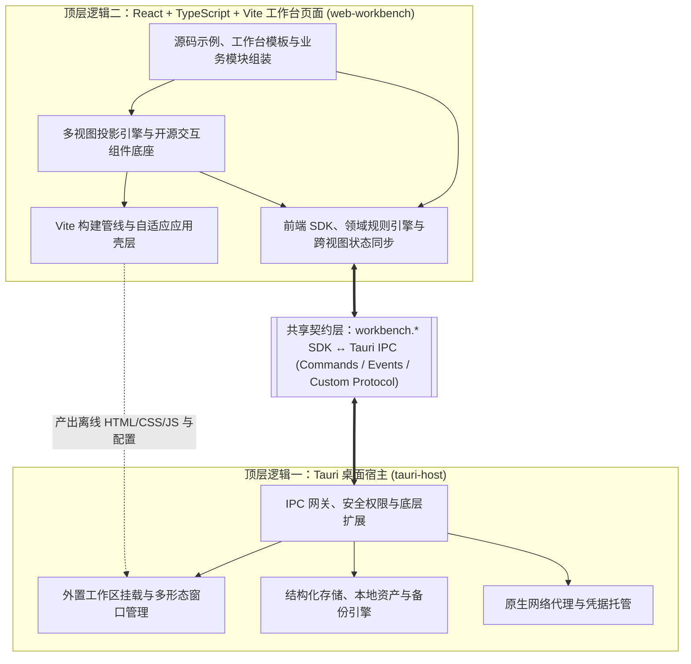

# 个人自定义工作台架构总览与开发导航

> **文档级维护约定**：本目录遵循“根架构文档 + 共享设计文档 + 模块下钻文档”分层体系。跨端公共需求、选型与通信契约统一收敛于 `shared/`；顶层架构严格划分为 **Tauri 桌面宿主（`tauri-host/`）** 与 **React + TypeScript + Vite 工作台页面（`web-workbench/`）** 两大逻辑域。下钻文档仅描述模块特有的职责边界、架构关系、接口契约、关键决策与验收口径，严禁写入实现代码、常识科普与跨文档重复描述。

---

## 一、系统定位与交付范式

本系统是一套脱离 AI Agent 侧栏浏览器独立运行的 **本地优先（Local-First）个人自定义工作台**。系统采用 **“预编译桌面运行器 + 本机 Agent 可持续编辑构建的前端工作台”** 双层解耦交付架构：

- **Tauri 桌面宿主（固定运行器）**：由平台方统一研发、编译与分发，负责独立桌面窗口管理、外置页面目录挂载、SQLite 结构化存储、本地附件托管、原生网络代理及安全权限隔离。日常业务迭代无需客户安装 Rust 工具链或重新编译宿主。
- **React + TypeScript + Vite 工作台页面（可编辑前端）**：源码与运行时配置存放于客户本机工作台目录，由客户的本地编码 Agent 按需修改，经配套前端构建管线编译为离线自包含的静态 HTML/CSS/JS 产物并触发窗口热刷新。用户业务数据与前端代码物理隔离，重写界面不丢失历史数据。

---

## 二、全局文档导航

### 1. 共享设计文档（`shared/`）

| 文档 | 核心管辖范围 |
| :--- | :--- |
| [产品需求规格与系统边界](shared/product-requirements-and-boundaries.md) | 核心使用流、全局底座默认能力、12 大业务域（68 项功能规格）需求全景、系统明确不做项 |
| [技术栈选型与关键架构决策](shared/tech-stack-and-decisions.md) | 宿主与页面技术栈选型矩阵、容器与框架取舍依据、Agent 时代轻量化源码交付策略、离线与开源合规约束 |
| [跨端通信契约与公共数据规范](shared/ipc-contract-and-data-model.md) | 宿主与前端职责分界、三层接口抽象体系（通用/业务/底层）、IPC 通信与异常语义、公共记录模型与配置契约 |

### 2. 顶层逻辑一：Tauri 桌面宿主（`tauri-host/`）

| 子模块文档 | 核心职责定位 |
| :--- | :--- |
| [外置工作区挂载与多形态窗口管理](tauri-host/window-and-workspace.md) | 外置静态产物协议加载、热刷新触发、侧栏/面板双预设形态、独立窗口状态记忆与多屏缩放适配 |
| [结构化存储、本地资产与备份引擎](tauri-host/data-and-assets.md) | SQLite 可扩展记录引擎、原子批处理事务、受控数据库迁移、本地附件隔离存储、配置读写与版本化备份恢复 |
| [原生网络代理与凭据托管](tauri-host/http-and-credentials.md) | 原生 HTTP 请求代理、CORS 跨域穿透、超时与取消控制、运行时地址授权及连接凭据安全注入 |
| [IPC 网关、安全权限与底层扩展](tauri-host/security-and-extensions.md) | 命令与事件桥接路由、Capabilities 最小权限控制、路径沙箱校验及受控底层 SQL/文件扩展接口 |

### 3. 顶层逻辑二：React + TypeScript + Vite 工作台页面（`web-workbench/`）

| 子模块文档 | 核心职责定位 |
| :--- | :--- |
| [Vite 构建管线与自适应应用壳层](web-workbench/build-and-app-shell.md) | 零外链离线打包与监听刷新管线、深浅色主题体系、基于容器查询的双形态自适应壳层、全局检索与状态栏 |
| [前端 SDK、领域规则引擎与跨视图状态同步](web-workbench/sdk-and-domain-services.md) | `workbench.*` 类型化 SDK 封装、高频业务规则（重复任务/子任务/顺延/预算等）纯逻辑编排、同源数据跨视图响应式同步 |
| [多视图投影引擎与开源交互组件底座](web-workbench/ui-primitives-and-views.md) | 列表/卡片/看板/日历/四象限/表格多视图投影、开源基础库本地集成、窄窗组件降级、图片前端压缩与格式化导出 |
| [面向 Agent 的源码示例、工作台模板与业务模块组装](web-workbench/templates-and-modules.md) | 可读可改的业务源码示例、三层定制解耦规范、首发 6 大参考模块与整套工作台模板、12 域扩展指南与 Token 效能验收基准 |

### 4. 用户内容开发指南（随 `web-workbench` 交付）

面向利用本系统编写 React + TypeScript + Vite 前端代码完成个人工作台的客户与本机 AI Agent，全套内容开发指南收敛于 `web-workbench/docs/` 专用目录，遵循“根架构文档 + 共享设计文档 + 模块下钻文档”分层规范：

- 🧭 [工作台前端开发指南总览与 Agent 导航](../web-workbench/docs/README.md)：全局体系认知、Agent 作业拓扑、依赖顺序与标准 5 步开发流。
- 📐 [工作台运行时与开发公共规范](../web-workbench/docs/shared/workbench-runtime-and-conventions.md)：离线零外链底线、单一事实源范式、响应式单向数据流与主题设计令牌。
- 🔌 [宿主开放能力与前端 SDK 契约](../web-workbench/docs/modules/host-and-sdk-interfaces.md)：通用资源接口（records/assets/config/backup/window）、业务动作层与 React Hooks。
- 🧩 [前端可复用控件与多视图引擎](../web-workbench/docs/modules/reusable-ui-and-views.md)：基础原语（Button/Input/Select/Badge/Dialog）、多视图投影套件、无头表格、排程日历、统计图表与媒体导出。
- 🏗️ [业务模块组装与工作台模板扩展](../web-workbench/docs/modules/custom-modules-and-templates.md)：模块三层解耦结构、参考模块实现剖析、新增自定义模块路径与 12 域扩展指南。
- 🖼️ [工作台内容布局规范](../web-workbench/docs/content-layout.md)：页面与宿主边界、外壳直角铺满、滚动区域分配与外观回归验收基准。

---

## 三、顶层架构与模块拓扑

---

## 四、模块依赖顺序与变更影响边界

### 1. 研发依赖顺序

1. **契约先行**：冻结 [跨端通信契约与公共数据规范](shared/ipc-contract-and-data-model.md) 中的通用记录 Schema、运行时配置结构及 IPC 命令签名。
2. **宿主底座并行构建**：优先实现 `security-and-extensions`（IPC 路由与权限骨架）、`window-and-workspace`（外置目录挂载与窗口控制）及 `data-and-assets`（SQLite 与附件、配置读写），随后接入 `http-and-credentials`。
3. **前端核心层落地**：基于宿主契约构建 `build-and-app-shell`（离线构建与自适应壳层）与 `sdk-and-domain-services`（类型化 SDK 与跨视图状态同步）。
4. **视图底座与示例组装**：落地 `ui-primitives-and-views` 的共享视图投影与开源交互封装，最后交付 `templates-and-modules` 中的首发参考模块与成品模板。

### 2. 日常演进的变更隔离边界

| 变更类型 | 涉及层级 | 是否需要重编译 Tauri 宿主 |
| :--- | :--- | :--- |
| 新增常规业务模块、修改布局样式、增减扩展字段、配置窗口形态或授权外部 API | `web-workbench` 源码与运行时 JSON 配置 | **否**（前端重新构建并刷新窗口即可生效） |
| 新增通用查询辅助方法、封装高频业务动作（如完成重复任务） | `sdk-and-domain-services`（前端 SDK 层） | **否**（复用通用记录接口与宿主原子批处理命令） |
| 升级底层 SQLite 物理表结构 | `data-and-assets` 迁移机制 | **视迁移定义而定**（须执行显式版本迁移，严禁假设刷新页面可自动完成迁移） |
| 接入操作系统新原生能力（如系统级任务栏停靠 AppBar、新型硬件外设） | `tauri-host` 原生命令或插件 | **是**（升级并重新分发桌面运行器） |

---

## 五、开发优先级规划

- **P0（最小可运行闭环）**：完成外置工作区加载与热刷新、侧栏/面板双形态窗口及状态记忆、通用 `records`（含原子批处理）/`assets`/`config` 宿主能力、Vite 离线打包管线、自适应应用壳层、`workbench.*` 核心 SDK、预置示例数据导入导出备份闭环。
- **P1（高频业务与核心体验完备）**：交付跨视图同源联动底座（列表/卡片/看板/日历/表格/四象限）、图片前端压缩与附件联动、原生 `http` 代理与凭据托管、首发 6 大高频源码示例（今日聚焦、待办列表、日历、习惯矩阵、指标卡、速记）及 2~3 套预设工作台模板。
- **P2（高阶扩展与效能实证）**：按需开放受控底层 `db`/`files` 扩展接口、执行 Agent 空白开发 vs 源码示例改造的 Token 与迭代轮次 A/B 实证评估，按真实高频复写痛点演进领域 SDK；远期视需求评估系统级屏幕区域独占停靠（AppBar）。

当前已落地 P0 宿主的外置产物加载与入口监听刷新、双形态窗口、通用记录事务、图片资产、配置和版本化 JSON 备份恢复，命令基线见共享通信契约。前端已接入资源 SDK、跨视图订阅、六个参考模块及三套模板，并以 TanStack Table、FullCalendar MIT 标准版和 Recharts 承载复杂视图。P1 宿主网络代理与凭据托管尚未接入，前端网络接口明确返回不可用。
