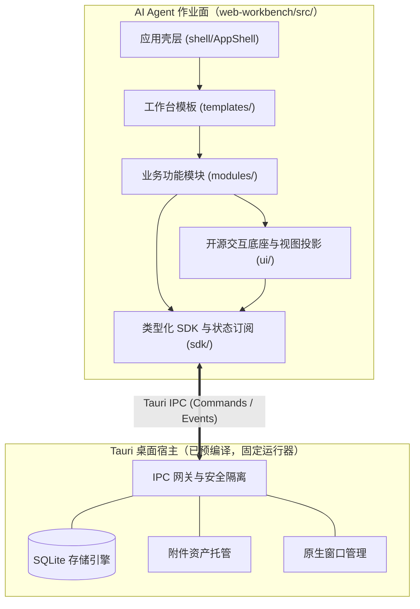
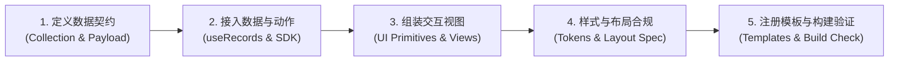

# 个人工作台前端开发指南：总览与 Agent 导航

> **文档级维护约定**：本文档是面向利用本框架编写个人工作台前端页面（React + TypeScript + Vite）的 **根架构与开发导航文档**。文档体系遵循“根架构文档 + 共享设计文档 + 模块下钻文档”分层规范。本文负责全局体系认知、架构拓扑、依赖顺序与 Agent 作业路径；跨模块运行约束收敛于 `shared/`；具体接口、控件与组装模式收敛于 `modules/`。严禁堆砌冗余教学代码与跨文档重复描述。

---

## 一、系统认知与 Agent 作业定位

本工作台采用 **“预编译桌面运行器（`tauri-host`） + 可编辑前端工作台（`web-workbench`）”** 的解耦架构。

- **宿主角色与启动**：由平台预编译分发或通过源码启动（在仓库根目录执行 `npm run host:dev` 启动宿主开发窗口；或通过桌面运行器可执行文件挂载指定静态产物 `tauri-host.exe --workspace web-workbench/dist`）。宿主负责原生窗口管理、SQLite 物理持久化、本地图片托管与原子事务保障。日常业务组件迭代**无需重新编译宿主**。
- **Agent 作业面**：AI Agent 的**唯一作业目录为 `web-workbench/src/`**。Agent 通过修改 React 组件、调用 `workbench.*` SDK 以及调整配置，即可完成个人工作台的定制与全功能扩展。
- **开发与验证闭环**：在 `web-workbench/` 目录下执行 `npm run build` 构建离线产物，产物输出至 `web-workbench/dist/`（官方构建示例入口：[dist/index.html](../dist/index.html)），宿主监听产物更新并自动触发窗口热刷新；或执行 `npm run dev` 启动前端开发服务器进行快速调试。**环境边界注意**：在纯浏览器环境（未连接宿主运行器）下，`useRecords` 会静默返回空数组 `{ data: [], loading: false, error: null }`，只有直接命令式调用 SDK 时才会抛出 `HOST_UNAVAILABLE`；开发者切勿将无宿主下的静默空数据误判为集合为空，全量持久化与窗口交互必须在桌面宿主中验证。

---

## 二、开发文档拓扑与分层导航

| 文档层级 | 文档路径 | 核心管辖范围与 Agent 阅读指南 |
| :--- | :--- | :--- |
| **根架构文档** | [本文件](README.md) | 全局体系认知、模块关系拓扑、开发依赖顺序与 Agent 任务作业路径 |
| **共享设计文档** | [工作台运行时与开发公共规范](shared/workbench-runtime-and-conventions.md) | 网络依赖模式（离线零外链 vs 联网扩展）、npm 依赖安装规范、单一事实源范式、响应式单向数据流、容器自适应与主题语义令牌 |
| **模块下钻文档** | [宿主开放能力与前端 SDK 契约](modules/host-and-sdk-interfaces.md) | `workbench.*` 三层接口规范、通用记录增删改查/原子批处理、资产管理、配置窗口控制与 React Hooks |
| **模块下钻文档** | [前端可复用控件与多视图引擎](modules/reusable-ui-and-views.md) | 基础交互原语（Button/Input/Select/Badge/Dialog）、多视图投影套件（六视图一体化）、复杂表格日历、统计图表与导出工具 |
| **模块下钻文档** | [业务模块组装与工作台模板扩展](modules/custom-modules-and-templates.md) | 参考模块三层解耦结构、新增自定义业务模块端到端路径、工作台模板注册切换与 12 大业务域扩展模式 |
| **模块下钻文档** | [工作台内容布局规范](content-layout.md) | 页面与宿主边界、外壳直角铺满、滚动区域与滚动条显示策略、外观回归测试口径 |

---

## 三、Agent 标准作业流程与依赖顺序

当接收到用户的定制工作台任务时，AI Agent 应严格遵循以下 5 步依赖顺序执行，严禁颠倒次序：

1. **定义数据契约**：明确业务实体归属的集合名称（`collection`）与 TypeScript `Payload` 结构，设计标签、业务日期及是否需关联附件资产。遵循单一事实源，避免重复建表。
2. **接入数据与动作**：如需第三方工具库，可在根目录通过 `npm install <pkg> -w web-workbench` 安装纯前端依赖；使用 `useRecords(collection)` 订阅数据流，使用 `useAction()` 包裹异步修改动作，调用 `workbench.records.*` 或第二层领域动作执行读写。
3. **组装交互视图**：优先复用 `src/ui/` 中的现有控件与视图引擎（多视图容器、表格、日历、图表），覆盖“加载中、空列表、错误提示、正常渲染”四种界面状态。
4. **样式与布局合规**：离线模式下全部样式引用内置 CSS 语义变量（`var(--text-primary)` 等），图标使用 Emoji/Unicode 或内联 SVG；联网扩展模式下经用户许可可通过 CDN 引入 Tailwind CSS 或外部图标库。依赖 `@container` 容器查询实现侧栏（窄窗）与面板（宽窗）自适应，严禁页面整窗圆角与双重滚动。
5. **注册模板与构建验证**：将模块组装至对应模板或 `WORKBENCH_TEMPLATES` 中，依次运行 `npm run check`（类型、Lint 与格式检查）、`npm run test`（Vitest 自动化测试）与 `npm run build`，确保功能完备、构建通过且回归用例全部绿灯。

---

## 四、Agent 任务分类与查阅索引

| Agent 任务场景 | 推荐查阅文档 | 核心操作指引 |
| :--- | :--- | :--- |
| **新增全新业务模块**（如记账、图书清单、饮食追踪） | [业务模块组装与模板扩展](modules/custom-modules-and-templates.md) [宿主开放能力与前端 SDK](modules/host-and-sdk-interfaces.md) | 声明自定义 Collection 与 Payload 类型，通过 `useRecords` 获取数据并调用通用 `records` 接口落盘，无感继承全局搜索与备份能力 |
| **修改现有模块外观或布局**（如重写待办卡片、更换配色） | [前端可复用控件与多视图](modules/reusable-ui-and-views.md) [工作台内容布局规范](content-layout.md) | 复用现有 Collection 契约，仅重构展示层与交互层 TSX，通过 CSS 主题令牌调整外观，确保历史数据零损坏 |
| **新增可视化图表或统计卡片** | [前端可复用控件与多视图](modules/reusable-ui-and-views.md) | 复用 `MetricCard`、`ProgressRing`、`YearHeatmap` 或 Recharts 图表封装，计算衍生指标并展示 |
| **新增或切换工作台模板** | [业务模块组装与模板扩展](modules/custom-modules-and-templates.md) | 在 `src/templates/` 编写新模板组件并在 `index.ts` 的 `WORKBENCH_TEMPLATES` 数组中声明 |
| **处理图片上传与文件导出** | [宿主开放能力与前端 SDK](modules/host-and-sdk-interfaces.md) [前端可复用控件与多视图](modules/reusable-ui-and-views.md) | 使用 `optimizeImageFile` 前端等比压缩后导入 `workbench.assets`；使用 `exportUtils` 实现 CSV、剪贴板与只读快照导出 |
| **排查窗口滚动、圆角与黑边异常** | [工作台内容布局规范](content-layout.md) | 检查外壳 `#workbench` 是否铺满直角，检查容器是否设置 `min-height: 0` 与 `overflow: auto` |
