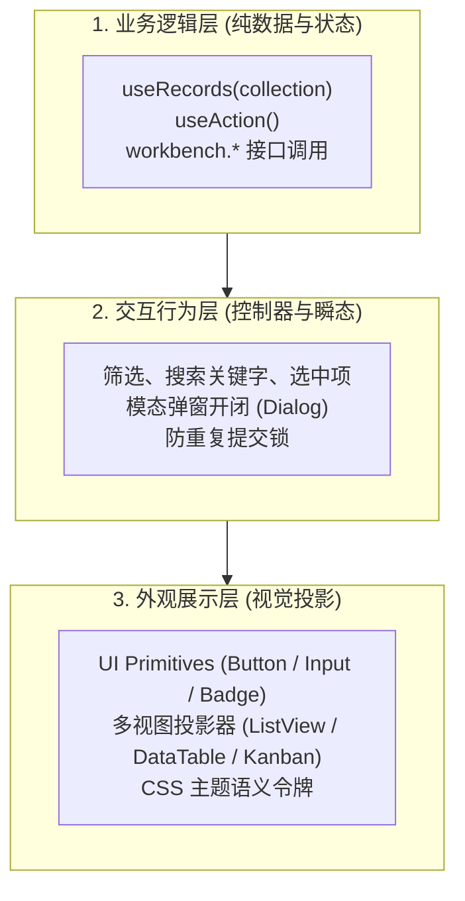

# 业务模块组装与工作台模板扩展

> **共享规则引用**：遵循 [工作台运行时与开发公共规范](../shared/workbench-runtime-and-conventions.md) 的单一事实源与设计令牌体系，配合 [前端可复用控件与多视图引擎](reusable-ui-and-views.md) 完成页面搭建。

---

## 一、模块三层解耦结构

为确保客户或 AI Agent 在大幅重构界面、更换视觉风格时**绝不破坏用户的历史业务数据**，所有业务功能模块均须遵循三层解耦范式：



- **改版零损毁守则**：只要保持第一层的 `collection` 名称与 `Payload` 契约不变，Agent 可以任意重写第二层交互与第三层 JSX/CSS。构建刷新后，原有历史数据将自动注入新界面。

---

## 二、首发参考模块设计解析（`src/modules/`）

工程内已交付 6 个内置且具备自动化测试用例覆盖的参考模块，Agent 开发新模块前可优先查阅对应源码（自动化测试覆盖了领域逻辑推算与多视图状态切换；原生窗口动作与本地文件打印需配合桌面运行器实测验证）：

| 模块名称 | 目录路径 | 核心数据集合 | 业务特性与交互模式 |
| :--- | :--- | :--- | :--- |
| **今日聚焦** (`TodayFocus`) | `src/modules/TodayFocus/` | `tasks` | 自动聚合逾期项、今日到期项与未来 3 天待办；存在逾期时全卡片边框与背景自动变红预警（`--color-overdue-border`）；提供一键完成与一键顺延操作 |
| **待办清单** (`TodoList`) | `src/modules/TodoList/` | `tasks` | 多清单分组管理、优先级过滤、子任务展开与联动推算、周期性重复规则设定；无缝挂载六视图投影容器（`MultiViewContainer`） |
| **日历排程** (`CalendarSchedule`) | `src/modules/CalendarSchedule/` | `events` + `tasks` | 将日程事件与待办任务叠加投影在 FullCalendar 上；支持拖拽改期；在容器宽度 `< 600px` 时自动降级为紧凑单日列表 |
| **习惯打卡** (`HabitMatrix`) | `src/modules/HabitMatrix/` | `habits` | 每日打卡状态勾选、连续打卡天数计算、断卡归因录入弹窗、集成 365 格年度打卡热力图（`YearHeatmap`） |
| **量化看板** (`MetricsDashboard`) | `src/modules/MetricsDashboard/` | `metrics` + `tasks` | 核心 KPI 指标卡片（`MetricCard`）、今日任务完成率环形图（`ProgressRing`）、近 7 天完成趋势折线图（`LineChart`）与横向柱状图（`BarChart`） |
| **速记灵感** (`QuickNotes`) | `src/modules/QuickNotes/` | `notes` + `assets` | 灵感速记与置顶卡片；集成本地图片附件管理（通过 `optimizeImageFile` 压缩后导入 `workbench.assets`）；离开页面前自动清理未引用的临时图片 |

---

## 三、新增自定义业务模块标准路径（Agent 实战指引）

当用户需要新增一个全新领域模块（例如“图书阅读管理” `books` 或“轻量记账” `finance`）时，Agent 应遵循以下标准 4 步法：

### 步骤 1：规划数据模型与引入依赖

若业务模块需要第三方纯前端工具库（如数学计算、日期处理），可在仓库根目录执行 `npm install <pkg> -w web-workbench` 安装。

在 `src/sdk/types.ts` 中或模块同级目录下定义数据载荷接口：

```typescript
// 示例：轻量记账载荷
export interface FinancePayload {
  [key: string]: unknown;
  type: 'income' | 'expense';  // 收支类型
  amount: number;             // 金额
  category: string;           // 分类（如餐饮、数码、交通）
  account?: string;           // 账户（如微信、支付宝）
  note?: string;              // 备注说明
}
```

### 步骤 2：编写业务模块组件

新建 `src/modules/FinanceTracker/FinanceTracker.tsx`。必须完整覆盖 **加载中态、空数据态、错误警示态与正常交互态**：

```tsx
import React, { useState } from 'react';
import { useRecords, useAction, workbench, formatDate } from '../../sdk';
import { Button, Input } from '../../ui';
import type { FinancePayload } from './types';

export const FinanceTracker: React.FC = () => {
  const action = useAction();
  // 1. 响应式订阅集合，传入 collection 名称
  const { data: records, loading, error: loadError } = useRecords<FinancePayload>('finance');

  const [amount, setAmount] = useState('');
  const [category, setCategory] = useState('餐饮');
  const [type, setType] = useState<'income' | 'expense'>('expense');

  // 2. 使用 useAction 包裹落盘操作
  const handleAdd = () => action.run(async () => {
    const val = parseFloat(amount);
    if (isNaN(val) || val <= 0) throw new Error('请输入有效金额');

    await workbench.records.create<FinancePayload>('finance', {
      payload: { type, amount: val, category },
      tags: [category, type],
      businessDate: formatDate(new Date()),
      archived: false,
    });
    setAmount('');
  });

  // 3. 状态覆盖：加载中
  if (loading) {
    return <div className="module-loading">正在读取记账记录...</div>;
  }

  // 4. 正常界面组装
  return (
    <div className="module-container" style={{
      background: 'var(--bg-surface)',
      border: '1px solid var(--border-subtle)',
      borderRadius: 'var(--radius-lg)',
      padding: '16px',
    }}>
      {/* 错误提示态 */}
      {(loadError || action.error) && (
        <div role="alert" style={{ color: 'var(--color-p0)', marginBottom: '8px' }}>
          {loadError?.message || action.error}
        </div>
      )}

      <h3>💰 个人收支记账</h3>
      
      {/* 操作表单 */}
      <div style={{ display: 'flex', gap: '8px', marginBottom: '12px' }}>
        <select
          value={type}
          onChange={(e) => setType(e.target.value as 'income' | 'expense')}
          style={{
            background: 'var(--bg-muted)',
            color: 'var(--text-primary)',
            border: '1px solid var(--border-subtle)',
            borderRadius: 'var(--radius-md)',
            padding: '0 8px',
          }}
        >
          <option value="expense">支出</option>
          <option value="income">收入</option>
        </select>
        <Input
          placeholder="分类"
          value={category}
          onChange={(e) => setCategory(e.target.value)}
          style={{ width: '100px' }}
        />
        <Input
          placeholder="金额"
          type="number"
          value={amount}
          onChange={(e) => setAmount(e.target.value)}
        />
        <Button variant="primary" disabled={action.pending} onClick={handleAdd}>
          {action.pending ? '记录中...' : '记一笔'}
        </Button>
      </div>

      {/* 空数据引导态 */}
      {records.length === 0 ? (
        <div style={{ color: 'var(--text-muted)', fontSize: '13px' }}>暂无收支记录，立即记一笔吧！</div>
      ) : (
        <ul style={{ listStyle: 'none', padding: 0, margin: 0 }}>
          {records.map((item) => (
            <li key={item.id} style={{ display: 'flex', justifyContent: 'space-between', padding: '6px 0' }}>
              <span>{item.payload.category}</span>
              <strong style={{ color: item.payload.type === 'income' ? 'var(--color-revenue)' : 'var(--text-primary)' }}>
                {item.payload.type === 'income' ? '+' : '-'}{item.payload.amount} 元
              </strong>
            </li>
          ))}
        </ul>
      )}
    </div>
  );
};
```

### 步骤 3：在模块索引中导出

修改 `src/modules/index.ts`，导出新模块：
```typescript
export * from './FinanceTracker/FinanceTracker';
```

---

## 四、工作台模板（Templates）机制与装配

工作台的外壳通过模板渲染主体内容。所有可用模板在 `src/templates/index.ts` 中集中声明。

### 1. 模板契约（`src/templates/types.ts`）

```typescript
export interface WorkbenchTemplate {
  id: string;               // 唯一模板标识（持久化于配置 workbench.activeTemplate）
  name: string;             // 模板显示名称
  description: string;      // 模板简介说明
  icon: string;             // 标识 Emoji 或图标字符
  render: () => React.ReactNode; // 渲染函数
}
```

### 2. 现存三套预设模板

1. **全能效率工作台 (`productivity`)**：双栏弹性布局。左栏排布“今日聚焦 + 待办多视图”，右栏排布“日历排程 + 习惯矩阵 + 指标看板 + 速记灵感”。
2. **极简专注工作台 (`minimal`)**：单栏极简流。聚焦于“今日聚焦 + 四象限矩阵 + 核心完成率指标卡”，剔除多余干扰。
3. **习惯复盘与知识库 (`knowledge`)**：专注复盘。以 365 格习惯热力图、断卡归因录入及富附件速记笔记为核心。

### 3. 新建或替换模板

要在工作台中新增一套专属模板（例如“财务与项目工作台”）：
1. 在 `src/templates/FinanceProject.tsx` 中编写模板组件，按需编排布局网格；
2. 在 `src/templates/index.ts` 的 `WORKBENCH_TEMPLATES` 数组中追加该模板定义；
3. 用户即可在工作台顶部标题栏的模板切换下拉菜单中一键切换激活。

---

## 五、12 大业务域扩展模式参考与 Agent 验收口径

Agent 在拓展个性化工作台时，可参考以下标准化集合命名与索引字段：

| 业务域分类 | 推荐 Collection | 推荐 Payload 关键字段 | 关联索引约定 |
| :--- | :--- | :--- | :--- |
| **1. 待办与多清单** | `tasks` | `title`, `priority`, `dueDate`, `completed`, `subtasks`, `recurRule` | `businessDate` 为截止日期，`tags` 为清单分类 |
| **2. 日历与排程** | `events` | `title`, `startDate`, `startTime`, `endDate`, `allDay`, `location` | `businessDate` 为起始日期 |
| **3. 习惯与打卡** | `habits` | `title`, `targetFrequency`, `logs`, `failReasons` | `tags` 为分类标签 |
| **4. 指标与核算** | `metrics` | `category`, `name`, `value`, `unit`, `target`, `changeRate` | `tags` 为统计维度 |
| **5. 灵感与速记** | `notes` | `title`, `content`, `pinned` | `assetIds` 关联本地图片 |
| **6. 财务与记账** | `finance` | `type`, `amount`, `category`, `account`, `note` | `businessDate` 为发生日期，`tags` 记收支 |
| **7. 身体与健康** | `health` | `metricType`, `value`, `unit`, `sleepHours`, `mood` | `businessDate` 为测量日期 |
| **8. 物品与库存** | `inventory` | `name`, `quantity`, `threshold`, `location`, `price` | `tags` 为存放位置/品类 |
| **9. 人脉与互动** | `contacts` | `name`, `relationship`, `lastContactDate`, `birthday`, `notes` | `tags` 为关系圈层 |
| **10. 复盘与周报** | `reviews` | `cycle`, `summary`, `achievements`, `blockers`, `nextWeekPlan` | `businessDate` 为复盘周五/月末 |
| **11. 效率小工具** | `tools` | `toolName`, `settings`, `usageCount`, `lastUsed` | `tags` 为工具分类 |
| **12. 知识与书签** | `bookmarks` | `title`, `url`, `description`, `readStatus`, `rating` | `tags` 为知识主题 |

### Agent 作业验收检查表（Checklist）：

1. **检查与测试全绿**：依次执行并通过 `npm run check`（类型、Lint 与格式检查）和 `npm run test`（Vitest 自动化测试），必要时在 `tests/` 中为新模块核心领域逻辑补充用例。
2. **网络模式合规**：默认离线模式下严禁引入外部未打包资源；若用户自选开启联网扩展模式，仅允许引入权威 CDN 来源的 Tailwind CSS、Font Awesome / Material Icons 或 Google Fonts。
3. **单一事实源**：没有在本地组件中创建影子表；相同实体均读写规范的同一底层集合。
4. **自适应降级**：在侧栏窄窗（宽度约 400px）下无横向滚动条撕裂，组件自动变为流式单列或紧凑形态。
5. **主题令牌完备**：离线模式下背景色、文字颜色、边框颜色均使用 `--bg-*`、`--text-*`、`--border-*` 等 CSS 语义变量。
6. **状态覆盖完整**：组件具备清晰的加载状态、空数据引导状态及操作错误警示。
7. **构建与示例对照**：执行 `npm run build` 产物无报错；页面外观可参照构建后的示例页面 [dist/index.html](../../dist/index.html) 进行回归比对。
