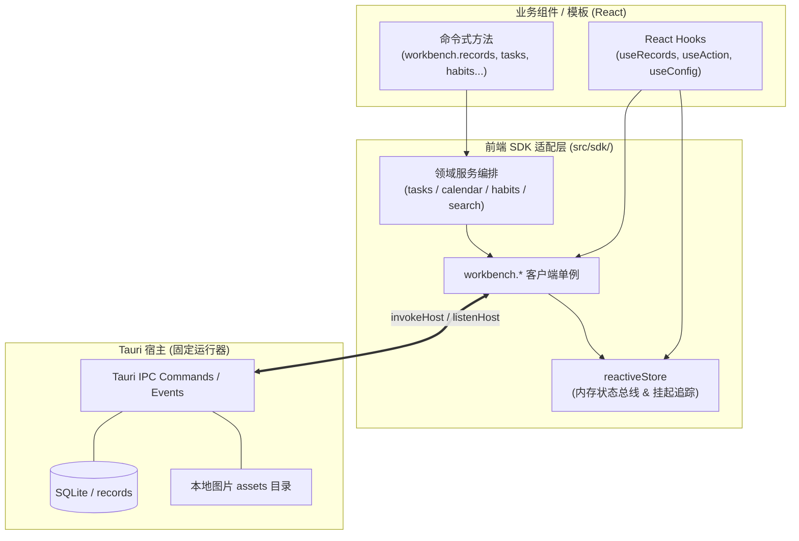

# 宿主开放能力与前端 SDK 契约

> **共享规则引用**：遵循 [工作台运行时与开发公共规范](../shared/workbench-runtime-and-conventions.md) 中的单一事实源范式与响应式单向数据流。所有跨进程通信均通过 `src/sdk/` 封装的类型化接口完成，严禁在业务组件中直接引入 Tauri 底层 IPC 原语。

---

## 一、职责边界与架构关系

- **前端 SDK（`src/sdk/`）**：负责将宿主暴露的底层 Tauri IPC 命令归一化为标准的 Promise 异步方法与 React Hooks，向外暴露 `workbench.*` 全局客户端对象与类型声明。
- **业务消费层（`src/modules/` / `src/templates/`）**：通过导入 SDK 提供的 Hooks 或方法读写数据，无需关心底层的 SQLite 表结构、锁竞争或文件写入细节。



---

## 二、第一层：通用资源接口（`workbench.*`）

通用资源接口覆盖绝大多数自定义模块的基础数据读写。

### 1. 结构化记录（`workbench.records`）

所有的业务实体在底层均作为记录存储在 `records` 引擎中。

| 方法签名 | 说明 | 关键约束与使用规范 |
| :--- | :--- | :--- |
| `queryAll<T>(query): Promise<RecordItem<T>[]>` | 自动遍历全量查询 | 内部以 1000 条为批次自动循环分页，返回该集合所有匹配记录 |
| `query<T>(query): Promise<RecordItem<T>[]>` | 单页条件查询 | `query` 包含：`collection`（必选）、`tags`（标签数组交集）、`businessDate`（单日期 `YYYY-MM-DD` 等值查询，非区间）、`archived`（软归档布尔值）、`filters`（载荷属性等值过滤 `[{ path: ['a'], value: 'x' }]`）、`sort`（排序字段）、`descending`、`limit`（默认 100，最大 1000）、`offset` |
| `get<T>(collection, id): Promise<RecordItem<T> \| null>` | 按 ID 精确查询 | 未找到时返回 `null` |
| `create<T>(collection, data, id?): Promise<RecordItem<T>>` | 创建单条记录 | `data` 包含 `{ payload, tags?, businessDate?, archived?, assetIds? }`。若不指定 `id`，由宿主自动生成 UUID |
| `update<T>(id, data, expectedUpdatedAt?): Promise<RecordItem<T>>` | 全量更新记录 | 全量覆盖原有 `payload` 与信封属性；更新时必须完整回传原记录的 `tags`、`businessDate`、`archived`、`assetIds` 等元属性，避免无意清空；可传入 `expectedUpdatedAt` 执行乐观并发锁校验 |
| `delete(id, expectedUpdatedAt?): Promise<void>` | 物理删除记录 | 物理删除单条记录；若被删除记录仍被其他实体有效引用，需自行在上层做好校验 |
| `batch<T>(operations): Promise<(RecordItem<T> \| null)[]>` | **原子多步批处理** | 单批最多支持 500 项操作，支持混合包含 `create`、`update`、`delete`。任一操作失败则全批自动原子回滚 |

- **大数据量查询策略**：`queryAll` 内部会自动按 1000 条为批次循环拉取全量。若单集合记录预计超过 500 条，建议在 `query` 或 `useRecords` 中传入带 `limit`、`businessDate`（单日精确匹配）或 `tags` 的 `RecordQuery` 进行条件分片查询，避免无界全量拉取造成前端内存与重渲染压力；跨日期区间的统计目前需在前端拉取后计算。

### 2. 本地图片资产（`workbench.assets`）

| 方法签名 | 说明 | 约束规则 |
| :--- | :--- | :--- |
| `import(bytes): Promise<AssetInfo>` | 导入本地图片资产 | `bytes` 为 `Uint8Array` 或字节数组。**单图大小 ≤ 10 MiB**，必须为真实的 PNG/JPEG/WebP/GIF 格式。上传前必须先经前端图片压缩工具处理为长边 ≤ 800px |
| `get(id): Promise<AssetInfo>` | 获取图片元信息与安全 URL | 返回 `{ id, mime, byteSize, width, height, url }`。`url` 为宿主受控的安全协议链接，可直接作为 `` 的 `src` 属性渲染 |
| `delete(id): Promise<void>` | 删除资产 | **已被任何记录的 `assetIds` 引用的图片禁止删除**，否则宿主拒绝并抛出 `CONFLICT` 异常 |

### 3. 配置读写与窗口形态（`workbench.config` & `workbench.window`）

- **`workbench.config`**：
  - `get(): Promise<AppConfig>`：获取当前完整配置（包含 `window`, `network`, `workbench` 三大命名空间）。
  - `update(namespace, patch): Promise<AppConfig>`：增量合并更新配置项。
  - `reset(namespace): Promise<AppConfig>`：重置特定命名空间为初始默认值。
- **`workbench.window`**：
  - `state(): Promise<WindowState>`：获取当前窗口模式（`sidebar` 侧栏 / `panel` 面板）、逻辑尺寸、最大化与最小化状态。
  - `control(action): Promise<void>`：控制窗口动作，可选：`minimize`, `maximize`, `restore`, `toggleMaximize`, `close`, `startDragging`。
  - `apply(config): Promise<WindowState>`：应用窗口模式切换或尺寸变更（如切换侧栏与面板）。
  - `reload(): Promise<void>`：触发工作台热刷新。

### 4. 数据备份与灾备（`workbench.backup`）

- `export(includeAssets = true): Promise<Backup>`：导出带 Schema 版本的全量 JSON 备份包。
- `validate(backup): Promise<BackupSummary>`：校验备份文件格式与记录/图片计数。
- `restore(backup): Promise<BackupSummary>`：全量替换恢复备份数据。
- `clear(): Promise<void>`：清空当前工作区所有记录与资产。

---

## 三、第二层：常见业务接口契约

面向高频高稳定的待办、习惯与日程场景，SDK 在通用记录之上编排了闭环的领域逻辑：

### 1. 任务流转（`workbench.tasks`）

- **`complete(task)`**：完成任务。若该任务包含周期性重复规则（`recurRule`：daily/weekly/monthly/interval），SDK 会在同一原子批处理事务内自动执行两项操作：
  1. 将当前任务标记为 `completed: true` 并记录完成时间；
  2. 根据重复规则推算下一次截止日期，生成并插入下一周期的新任务实例。
- **`toggleSubtask(task, subtaskId, completed)`**：切换子任务状态。若修改后该任务下的所有子任务均已完成，系统自动将主任务一并联动标记为完成。
- **`snooze(task, days = 1)`**：一键顺延。将截止日期向后推迟指定天数，并将载荷中的 `snoozeCount` 计数器累加 1。
- **`uncomplete(task)`**：撤销任务完成状态，恢复为待办中。

### 2. 习惯与复盘（`workbench.habits`）

- **`toggle(habit, date)`**：切换指定日期（`YYYY-MM-DD`）的打卡状态，自动在 `habit.payload.logs` 中置位或删除。
- **`recordFailure(habit, date, reason)`**：为断卡日期录入归因说明（如“身体不适”、“加班”），用于复盘分析。

### 3. 日程排程（`workbench.calendar`）

- **`create(payload)`**：创建日程事件。前置自动执行日期与起止时间格式合法性校验（要求 `YYYY-MM-DD` 与 `HH:mm`，结束时间必须晚于开始时间），自动写入 `events` 集合。**注意：时间冲突检测不在此处自动拦截**；若需排程冲突预警，上层组件应显式调用独立的纯函数 `detectEventConflicts(events)` 进行重叠分钟数计算与提示。
- **`reschedule(event, patch)`**：重新排程（改期或改时），执行同样的合法性校验后更新底层记录。

### 4. 跨集合检索（`workbench.search`）

- **`find(query, collections?, limit = 20): Promise<SearchResultItem[]>`**：在指定集合或全工作区集合中执行关键词模糊匹配，返回包含匹配标题、高亮文本及归属模块的统一搜索结果列表。

### 5. 数据种子服务（Data Seeding）

- **`checkAndSeedInitialData()`**：播种前优先检查 `config.workbench?.initialized` 标记，若未初始化则查询 `tasks`、`habits`、`notes`、`events` 四个集合；仅当四者均无任何数据时，自动播种 **3 条任务（逾期/今日/未来）、1 条习惯打卡、1 条置顶笔记（共 5 条，不包含日程事件）**，最后将 `initialized` 标记置为 true。
- **自定义集合边界**：自定义 Collection 不参与初次空库判定，系统亦不会为其自动生成演示数据，新模块须通过自身的空数据引导态（Empty State）承接冷启动，或在模块内提供手动初始化示例数据的操作。

---

## 四、React 响应式 Hooks 规范

为方便在 React 组件中以响应式方式消费 SDK，`src/sdk/hooks.ts` 导出了标准 Hooks：

| Hook 接口 | 参数 | 返回值与用法 |
| :--- | :--- | :--- |
| `useRecords<T>(collection, queryOptions?, deps?)` | 集合名、可选查询条件、依赖项 | 返回 `{ data: RecordItem<T>[], loading, error, refetch }`。自动建立响应式监听。**重要边界**：在纯浏览器环境（无宿主运行器，`hasHost() === false`）下，该 Hook 会静默返回 `{ data: [], loading: false, error: null }`，不会抛出 `HOST_UNAVAILABLE`；开发者切勿将此无宿主下的静默空数据误判为集合为空 |
| `useRecord<T>(collection, id)` | 集合名、记录 ID | 自动返回目标单条记录对象 `{ data, loading, error, refetch }` |
| `useConfig()` | 无 | 返回 `{ config: AppConfig, loading, error, update }`，响应工作台配置变更 |
| `useSaveStatus()` | 无 | 返回 `{ state: 'saved' \| 'saving' \| 'error', error }`，用于驱动保存状态展示 |
| `useWindowState()` | 无 | 返回 `{ state: WindowState, control, toggleMaximize }`，驱动标题栏窗口控制按钮 |
| `useGlobalSearch(query, collections?)` | 检索文本、可选集合限制 | 内置 150ms 防抖，返回 `{ results: SearchResultItem[], loading, error }` |
| `useAction()` | 无 | 封装异步动作执行器，返回 `{ pending: boolean, error: string, run(fn): Promise<void> }`，防重复点击并捕获异常 |

---

## 五、统一结构化错误（`HostError`）契约

当底层 IPC 或业务操作失败时，SDK 统一抛出结构化错误对象：

```typescript
export interface HostError {
  code: string;
  message: string;
  context?: {
    operation?: string;
    operationIndex?: number;
    [key: string]: unknown;
  };
}
```

### 错误码处理指南：

| 错误分类码 (`code`) | 产生场景 | 前端推荐处理方式 |
| :--- | :--- | :--- |
| `VALIDATION` | 参数格式错误、必填项缺失、日期不合法、图片超限 | 在输入框或表单下方直接展示高亮错误文案 |
| `CONFLICT` | 乐观并发锁冲突（`expectedUpdatedAt` 不匹配）、删除已被引用的图片 | 提示用户“数据已被外部更改，正在刷新”，调用 `refetch()` 重新获取最新数据 |
| `NOT_FOUND` | 目标记录或资产 ID 不存在 | 提示条目已不存在，并清理本地选中状态 |
| `PERMISSION_DENIED` | 尝试访问未受权的路径或调用被策略禁止的命令 | 提示权限不足 |
| `HOST_UNAVAILABLE` | 调用了当前运行器尚未开放的接口（如 P1 原生网络代理） | 向用户展示“该功能在当前运行器暂不可用”，优雅降级界面 |
| `IO` / `DATABASE` | 本地磁盘写入失败、SQLite 事务死锁 | 提示本地存储异常，通过 `useAction` 将错误渲染至模块容器内 |
