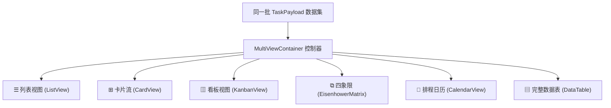

# 前端可复用控件与多视图引擎

> **共享规则引用**：遵循 [工作台运行时与开发公共规范](../shared/workbench-runtime-and-conventions.md) 的设计令牌（Tokens）体系与自适应容器原则，以及 [工作台内容布局规范](../content-layout.md) 的滚动条与客户区约束。本模块内所有组件均已接入主题语义变量。

---

## 一、组件底座定位与交付策略

- **源码白盒原语（`src/ui/primitives/`）**：基础按钮、输入框、标签、弹窗以轻量级源码形态交付，遵循 `shadcn/ui` 组合模式。AI Agent 可直接通读、导入或在保留接口契约的前提下微调内部样式。
- **样式方案与图标规范（离线 vs 联网模式）**：
  - **离线模式（默认）**：组件样式严格基于 `tokens.css` 设计令牌与局部 CSS，图标统一使用 Emoji、Unicode 字符（如 `🔍`, `💾`, `◨`, `▾`）或轻量内联 SVG。工程默认未安装 Tailwind CSS 与独立图标库，严禁直接书写未配置的原子类或外部字体引用。
  - **联网扩展模式（用户自选开启）**：在用户明确允许联网的前提下，支持通过 CDN 引入 Tailwind CSS（`https://cdn.tailwindcss.com`）、Font Awesome（cdnjs 源）或 Material Icons（Google Fonts CDN），以增强页面的视觉表现力。
- **开源引擎适配层（`src/ui/table/`、`calendar/`、`charts/`）**：针对高研发成本的数据表格（TanStack Table）、日历排程（FullCalendar MIT）与多轴图表（Recharts），工作台提供了统一的自适应薄包装；而进度环、热力图等轻量图形则采用内联 SVG 实现，兼顾性能与可维护性。
- **多视图投影体系（`src/ui/views/`）**：为同一数据集提供在列表、卡片、看板、四象限、日历、表格之间的无损切换控制器与通用筛选排序工具条。针对大数据量场景，`DataTable` 内置分页支持；`ListView` 与 `CardView` 推荐配合上游 `FilterSortToolbar` 进行条件收敛展示。

---

## 二、基础交互原语（`src/ui/primitives/`）

```typescript
import { Button, Input, Textarea, Select, Badge, Dialog } from '../ui';
```

| 组件名称 | 核心 Props 契约 | 交互与视觉特性 |
| :--- | :--- | :--- |
| **`Button`** | `variant?: 'primary' \| 'secondary' \| 'outline' \| 'ghost' \| 'destructive'`<br>`size?: 'sm' \| 'md' \| 'lg' \| 'icon'`<br>继承原生 `ButtonHTMLAttributes` | 统一圆角（`--radius-md`）与过渡动画；`disabled` 态自动降不透明度至 0.45 并锁定点击；`variant="primary"` 映射主题强调色 |
| **`Input`** | `error?: boolean`<br>继承原生 `InputHTMLAttributes` | 默认采用 `--bg-muted` 柔和底色；`error=true` 时边框高亮红圈（`--color-p0`）并提示异常 |
| **`Textarea`** | `error?: boolean`<br>继承原生 `TextareaHTMLAttributes` | 垂直可拉伸（`resize: vertical`），默认最小高度 64px，适配长文本与笔记输入 |
| **`Select`** | `options: { value: string; label: string }[]`<br>继承原生 `SelectHTMLAttributes` | 原生下拉框主题化包装，避免外部复杂浮层越出 WebView 导致裁剪问题 |
| **`Badge`** | `variant?: 'p0' \| 'p1' \| 'p2' \| 'overdue' \| 'revenue' \| 'neutral' \| 'outline'` | 统一业务语义胶囊标签；P0/P1/P2 用于优先级；overdue 用于逾期红框；revenue 用于达成绿标 |
| **`Dialog`** | `open: boolean`<br>`onClose: () => void`<br>`title: string`<br>`description?: string`<br>`footer?: ReactNode`<br>`maxWidth?: string` (默认 520px) | 基于 Radix UI 封装；**门面 Portal 挂载点显式限定在 `#workbench` 容器内**，确保弹窗不越出宿主客户区，完全符合窗口裁剪规范 |

---

## 三、多视图投影引擎（`src/ui/views/`）

### 1. 六视图一体化容器（`MultiViewContainer`）

`MultiViewContainer` 封装了个人工作台最常用的 6 种视图形态，支持同一批任务数据无感切换：



#### 组件 Props 契约：
```typescript
export interface MultiViewContainerProps {
  tasks: RecordItem<TaskPayload>[];
  onToggleComplete: (task: RecordItem<TaskPayload>) => Promise<void>;
  onSnooze: (task: RecordItem<TaskPayload>) => Promise<void>;
  onDelete: (taskId: string) => Promise<void>;
  onToggleSubtask?: (task: RecordItem<TaskPayload>, subtaskId: string, completed: boolean) => Promise<void>;
  onUpdateTask?: (id: string, updatedPayload: Partial<TaskPayload>) => Promise<void>;
  onRescheduleTask?: (taskId: string, newDueDate: string) => Promise<void>;
  onChangeQuadrant?: (task: RecordItem<TaskPayload>, quadrant: 'q1' | 'q2' | 'q3' | 'q4') => Promise<void>;
  onMoveToPriority?: (task: RecordItem<TaskPayload>, priority: 'P0' | 'P1' | 'P2') => Promise<void>;
  initialView?: 'list' | 'cards' | 'kanban' | 'matrix' | 'calendar' | 'table';
}
```

- **内置工具栏**：内置视图切换 Tabs、文本摘要一键复制、标准 CSV 导出、干净打印预览（`triggerPrint`）与静态只读 HTML 快照导出（`exportStaticHtmlSnapshot`）。
- **单一事实源守则**：视图切换仅改变渲染投影，拖拽看板修改状态、四象限修改优先级或表格行内改动均统一回写宿主，切换后各视图实时同步。

### 2. 独立投影视图组件

| 组件名称 | 适用场景 | 核心交互特性 |
| :--- | :--- | :--- |
| **`ListView`** | 高密度待办列表、清单明细 | 支持主任务勾选、逾期红标、展开/折叠子任务项、顺延天数快捷操作 |
| **`CardView`** | 富内容展示、宽屏浏览 | 响应式自适应网格，展示任务备注、截止时间、标签及子任务进度环 |
| **`KanbanView`** | 状态与优先级流动管理 | 默认划分为“P0 · 极高优 / 紧急”、“P1 · 高优先级”、“P2 · 日常 / 普通”、“已完成归档”四列；支持通过 `columns` 属性自定义列与过滤条件；支持原生 HTML5 拖拽改动优先级与状态 |
| **`EisenhowerMatrix`** | 优先级推进分析 | 划分 Q1（重要且紧急）、Q2（重要不紧急）、Q3（紧急不重要）、Q4（不紧急不重要）；支持拖拽直接改动象限与优先级 |
| **`FilterSortToolbar`** | 视图上游筛选条 | 提供输入框实时搜索、标签下拉筛选、优先级下拉、状态筛选（全部/进行中/已完成/逾期）及排序（更新时间/截止日期/优先级/创建时间） |

---

## 四、复杂交互适配层：表格与日历

### 1. 数据表格适配（`DataTable<T>`）

基于 `@tanstack/react-table` 封装，提供完整的无头表格功能：

```typescript
export interface ColumnDef<T> {
  key: string;
  header: string;
  width?: string;
  editable?: boolean;
  render?: (record: RecordItem<T>, isEditing: boolean) => React.ReactNode;
}

export interface DataTableProps<T = Record<string, unknown>> {
  records: RecordItem<T>[];
  columns: ColumnDef<T>[];
  onUpdateRecord?: (id: string, updatedPayload: Partial<T>) => Promise<void>;
  pageSize?: number; // 默认 10
}
```

- **行内就地编辑**：设置 `editable: true` 后，双击单元格即可进入编辑态，输入新值后按回车或点击确认即可触发 `onUpdateRecord` 提交保存。
- **内置特性**：列头搜索过滤、表头点击升降序、页码翻页与记录计数器。

### 2. 日历排程适配（`CalendarView`）

基于 FullCalendar MIT 标准版封装，严格限定在开源许可范围内：

- **Props 契约**：
  ```typescript
  export interface CalendarViewProps {
    tasks: RecordItem<TaskPayload>[];
    events?: RecordItem<ScheduleEventPayload>[];
    onSelectDate?: (date: string) => void;
    onRescheduleTask?: (taskId: string, newDueDate: string) => Promise<void>;
    onRescheduleEvent?: (eventId: string, patch: Partial<ScheduleEventPayload>) => Promise<void>;
    calendarOptions?: CalendarOptions;
  }
  ```
- **任务与日程混合投影**：将带截止日期的待办任务与日历事件合并展示在同一时间线上。
- **窄容器自适应降级**：内置 `ResizeObserver` 监听容器宽度。当容器宽度 `< 600px`（如处于侧栏模式）时，自动将复杂的月历多列网格降级为紧凑型“单日选择器 + 当日日程事项列表”，彻底避免字体挤压与横向溢出。
- **拖拽改期**：在宽窗月视图下，支持拖拽事件或任务至新日期格，自动调用 `onRescheduleTask` 或 `onRescheduleEvent`。

---

## 五、统计可视化底座（`src/ui/charts/`）

| 组件名称 | 基础类型 | Props 关键契约 | 使用场景 |
| :--- | :--- | :--- | :--- |
| **`MetricCard`** | 纯 CSS / 容器卡片 | `title: string`<br>`value: string \| number`<br>`unit?: string`<br>`changeRate?: number` (如 +12 或 -5)<br>`changePeriod?: string`<br>`variant?: 'default' \| 'overdue' \| 'revenue'` | 顶部核心 KPI 指标展示，支持逾期红标态与收益绿标态 |
| **`ProgressRing`** | 内联 SVG | `progress: number` (0~100)<br>`size?: number` (默认 80)<br>`strokeWidth?: number` (默认 8)<br>`color?: string`<br>`label?: string`<br>`sublabel?: string` | 仪表盘任务完成率环形百分比圈，轻量高效，零外部图表依赖 |
| **`YearHeatmap`** | 内联 SVG + 局部滚动 | `data: HeatmapDay[]` (`{ date, count, level }`)<br>`onSelectDay?: (day: HeatmapDay) => void` | 365 格 GitHub 风格年度习惯打卡热力图，水平轨道适配 `visible-scrollbar` |
| **`LineChart`** | Recharts 适配 | `data: { label: string; value: number }[]`<br>`height?: number` (默认 140)<br>`color?: string` (默认 `--accent-primary`)<br>`showPoints?: boolean` | 趋势走向、历史复盘周任务走势图，背景带平滑渐变面积填充 |
| **`BarChart`** | Recharts 适配 | `data: { label: string; value: number; color?: string }[]`<br>`maxVal?: number` | 横向分类柱状图，适合展示清单任务分布、时间投入占比 |
| **`PieChart`** | Recharts 适配 | `data: { label: string; value: number; color: string }[]`<br>`size?: number` (默认 140)<br>`innerRadiusRatio?: number` (默认 0.6) | 环形占比图，适合支出结构、任务优先级占比 |

---

## 六、媒体预处理与格式化导出工具

### 1. 前端图片等比压缩（`src/ui/media/imageOptimizer.ts`）

为避免原始大图占满 IPC 传输带宽并节约宿主磁盘空间，所有图片在调用 `workbench.assets.import` 前必须经过前端预处理：

```typescript
export async function optimizeImageFile(
  file: File,
  currentCount: number = 0,
): Promise<OptimizedImageResult>;
```
- **图片规格限制**：仅支持 `image/png`、`image/jpeg`、`image/webp`、`image/gif`，单条记录关联图片上限为 **9 张**（`MAX_ASSETS_PER_RECORD = 9`）。
- **等比压缩**：当原始图片长边超过 **800px** 时，自动通过 Canvas 进行高质量等比缩放编码（保持质量 0.85），输出 `Uint8Array` 字节流供 SDK 导入。

### 2. 导出与快照工具（`src/ui/export/exportUtils.ts`）

| 工具函数 | 功能契约 | 输出特性 |
| :--- | :--- | :--- |
| `copyTextToClipboard(text): Promise<boolean>` | 将格式化文本复制至系统剪贴板 | 常用于待办清单一键复制至外部聊天或笔记软件 |
| `exportRecordsToCSV(records, filename?)` | 导出 UTF-8 CSV 文件 | 包含 UTF-8 BOM 头，确保 Microsoft Excel 打开不出现中文乱码 |
| `triggerPrint()` | 调起系统打印窗口 | 配合 CSS `@media print` 样式，自动隐藏窗口外壳、操作按钮与输入框，仅保留白底黑字的数据内容 |
| `exportStaticHtmlSnapshot(title, records, filename?)` | 生成自包含只读 HTML 快照文件 | 将标题与当前记录固化为静态 HTML 页面下载至本地（默认文件名 `workbench_snapshot.html`），完全剔除所有增删改按钮，供用户进行安全外发或离线存档 |
