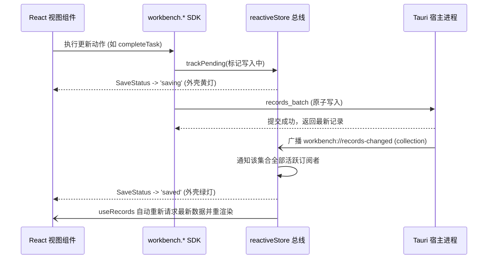

# 工作台运行时与开发公共规范

> **共享规则引用**：本文档承载所有前端开发模块必须共同遵守的公共运行时契约与设计底线。阅读各下钻模块文档前，必须先行对齐本文定义的离线底线、单一事实源范式、响应式数据流、容器自适应与设计令牌约定。

---

## 一、双层解耦与网络依赖模式

1. **宿主与页面职责分界**
   - **宿主负责**：SQLite 存储落盘、多记录原子事务、文件附件隔离存储、窗口原生边框控制与配置托管。
   - **页面负责**：React 视图投影、领域逻辑推算（如重复任务推算、连续打卡天数统计）、组件交互与数据组装。
   - 页面代码严禁假设自身具备物理文件读写权限或直接执行 SQLite 建表命令，一切外部能力均收敛于 `workbench.*` SDK。
   - **运行环境差异**：SDK 强依赖宿主 IPC 原语（`window.__TAURI__`）。若在纯浏览器环境运行 `npm run dev`（未启动宿主），调用 `workbench.*` 将抛出 `HOST_UNAVAILABLE`；完整的本地数据读写必须在 Tauri 桌面宿主中执行或加载构建产物（如 `dist/index.html`）。

2. **网络依赖模式与外链规范**
   前端允许用户自主选择是否开启联网依赖，从而决定资产加载策略：
   - **离线安全模式（默认 / 推荐）**：强制要求**离线零外链（Zero External Assets）**。
     - 前端所有构建产物使用相对路径（`base: './'`），图标、字体、三方依赖全部经 Vite 打包进本地静态产物。
     - 运行时严禁在 HTML/CSS/JS 中引入任何公网外部资源链接（例如公网 CDN、外部字体、公网图片等）。
     - 样式完全依托内置主题设计令牌（`tokens.css`）与局部样式，图标采用 Unicode/Emoji 字符或内联 SVG。
   - **联网扩展模式（用户自选开启）**：
     - 若用户显式配置允许依赖外部网络，前端支持通过权威 CDN 引入主流样式框架、图标与字体库以丰富视觉表现。
     - **社区最佳实践来源（统一通过 CDN 引入）**：
       - **CSS 框架**：Tailwind CSS（官方 Play CDN，如 `https://cdn.tailwindcss.com`）；
       - **图标库**：Font Awesome（cdnjs 稳定源，如 `https://cdnjs.cloudflare.com/ajax/libs/font-awesome/...`）或 Material Icons / Material Symbols（Google Fonts CDN，如 `https://fonts.googleapis.com/icon?family=Material+Icons`）；
       - **字体库**：Google Fonts（如 `Inter`、`Roboto`、`Noto Sans SC`：`https://fonts.googleapis.com/css2?...`）。
   - 当前宿主底层原生网络代理（`workbench.http`）暂未开放，业务组件不得在此阶段直接发起 `window.fetch` 请求业务数据接口。

3. **第三方 npm 依赖包准入规范**
   - 允许 Agent 为自定义业务模块安装新的 npm 依赖。
   - **安装命令规范**：统一在工程根目录执行 `npm install <pkg> -w web-workbench`，包管理器严格统一使用 npm。
   - **准入安全防线**：
     - 必须是纯前端可运行的 JavaScript / TypeScript 库（如通用数学计算、轻量数据结构、纯前端算法库等）；
     - 必须能被 Vite 完全离线静态编译打包，严禁引入依赖 Node.js 原生 C++ 扩展（Native Addons）或 Node.js 内置模块（如 `fs`, `path`, `child_process`）的服务端库；
     - 优先选用轻量、Tree-shakable 友好的现代 ESM 依赖包，控制构建包体积。

---

## 二、单一事实源范式（Single Source of Truth）

1. **严禁按视图私建数据副本**
   - 同一业务实体的所有视图（如待办列表、看板、四象限、日历、指标卡）必须读取和修改同一个底层集合（Collection，如 `tasks`）。
   - 严禁在视图组件内部使用 `useState`、`localStorage` 或私有 IndexedDB 长期缓存独立业务副本。一次数据变更，必须持久化至宿主，并通过状态总线驱动全工作台视图同步更新。

2. **可扩展通用记录模型（Envelope Pattern）**
   宿主持久化的所有实体均封装为标准的信封结构：

   | 信封字段 | 类型 | 说明与 Agent 使用规范 |
   | :--- | :--- | :--- |
   | `id` | `string` | 唯一标识符。可由前端提供（ASCII 字母/数字/下划线/连字符），缺省由宿主生成 UUID |
   | `collection` | `string` | 集合名称（如 `tasks`, `habits`, `notes`, `events`, `metrics` 或自定义模块标识） |
   | `createdAt` | `number` | 创建时间（Unix 毫秒整数），由宿主受控生成，前端只读 |
   | `updatedAt` | `number` | 最后更新时间（Unix 毫秒整数），用于乐观锁冲突检测 |
   | `tags` | `string[]?` | 业务标签数组。用于分类检索、过滤器与跨模块关联，建议使用小写字母 |
   | `businessDate` | `string?` | 业务基准日期（`YYYY-MM-DD` 格式），驱动日历归档、排序与全局搜索 |
   | `archived` | `boolean?` | 归档标记。`true` 表示软归档，默认查询通常过滤未归档项 |
   | `assetIds` | `string[]?` | 关联的宿主图片资产 ID 列表（单条记录上限 9 项，且必须指向已导入资产） |
   | `payload` | `Record<string, unknown>` | 业务结构化载荷。存储特定领域的自定义属性（如待办优先级、打卡记录、指标数值） |

3. **全局检索无感接入约定**
   外壳提供的全局检索（`Ctrl/Cmd + K`）对全工作台生效。为确保 Agent 新增的自定义模块能够被检索，模块在填充 `payload` 时应至少包含具有可读语义的 `title`、`name` 或 `content` 字符串字段；只要设置了该字段并按规范打上 `tags`，该实体无需额外注册即可自动纳入全局全文匹配。

---

## 三、响应式单向数据流与跨视图总线

工作台前端采用基于发布-订阅的内存态响应式数据流：



1. **响应式订阅（读流）**
   - 业务组件统一使用 `useRecords<T>(collection, queryOptions)` 读取数据并自动挂载监听。
   - 当任意视图或外部动作向该 `collection` 提交变更时，总线自动广播失效信号，所有订阅了该集合的组件自动重新拉取最新数据，开发者无需手动编写跨组件通知代码。

2. **全局保存状态指示器（写流）**
   - 所有经由 SDK 发起的落盘写入（`records`、`assets`、`config`、`backup`）均自动通过 `reactiveStore.trackPending()` 追踪挂起状态。
   - 应用外壳（`AppShell`）已内置全局保存状态指示器（`useSaveStatus()`），实时展示“保存中... / 已保存到本机 / 本地保存失败”。**各业务模块严禁重复绘制全局保存指示器**。

3. **操作防重与异常收敛（`useAction` 模式）**
   - 界面中的所有异步触发操作（如点击按钮保存、一键归档、导入导出）必须通过 SDK 提供的 `useAction()` 钩子包裹：
     ```tsx
     const action = useAction();
     // 执行异步动作，自动获得 pending（防重复点击）与 error（错误捕获）
     const handleSave = () => action.run(async () => {
       await workbench.records.update(id, data);
     });
     ```
   - 发生网络/存储异常时，`action.error` 会自动提取 `HostError.message`，模块仅需在容器内以文本或警示条形式呈现该错误信息。

---

## 四、自适应容器体系与主题语义令牌

### 1. 窗口模式与容器查询优先（`@container`）

宿主支持 **侧栏（Sidebar，窄窗，宽度约 360px~480px）** 与 **面板（Panel，宽窗，宽度 ≥800px）** 双形态。页面组件必须适配不同容器宽度：

- **禁止硬编码大宽度**：禁止对组件容器设置如 `width: 900px` 等固定数值，导致在侧栏形态下产生横向溢出。
- **优先使用 Flex/Grid 自适应与容器查询**：
  - 宽容器下：采用多列网格、并排看板或展开日历；
  - 窄容器下：自动流式折叠为单列列表、主从卡片或紧凑日程流。
- **收缩与滚动基准**：弹性子项须显式设置 `min-width: 0` 或 `min-height: 0`，避免被长文本撑大根节点（详见 [工作台内容布局规范](../content-layout.md)）。

### 2. 主题语义设计令牌（Design Tokens）

工作台内置深色（默认）与浅色两套主题，所有组件样式**严禁硬编码颜色 Hex 码**（如禁止使用 `#ffffff`、`#181920`），必须使用下表定义的 CSS 变量：

| 令牌分类 | CSS 变量名 | 语义说明 |
| :--- | :--- | :--- |
| **背景层级** | `--bg-workbench` | 工作台最外层底色 |
| | `--bg-surface` | 卡片、面板、模块标准容器背景 |
| | `--bg-surface-elevated` | 悬浮卡片、弹窗内容区背景 |
| | `--bg-surface-hover` | 列表项或按钮 hover 状态背景 |
| | `--bg-muted` | 输入框、次级标签底色 |
| **边框体系** | `--border-subtle` | 模块与卡片常规分割线、外边框 |
| | `--border-strong` | 强调状态、激活轮廓线 |
| | `--border-focus` | 输入框聚集光晕色 |
| **文字层级** | `--text-primary` | 正文标题、主要文本（深色下为浅白，浅色下为深灰） |
| | `--text-secondary` | 次要描述、标签文字、表头文字 |
| | `--text-muted` | 禁用文本、时间戳、占位符占位说明 |
| **品牌与状态** | `--accent-primary` | 主强调色、主要操作按钮背景 |
| | `--accent-hover` | 主强调色 hover 状态 |
| | `--accent-surface` | 主强调色半透明高亮背景（15% 不透明度） |
| **业务语义色** | `--color-p0` / `--color-p1` / `--color-p2` | 优先级颜色（P0 红色 / P1 橙黄色 / P2 蓝色） |
| | `--color-overdue` | 逾期预警文字红色 |
| | `--color-overdue-bg` / `--color-overdue-border` | 逾期模块背景与边框半透明警戒色 |
| | `--color-revenue` | 完成、打卡达成、正向收益翠绿色 |
| | `--color-revenue-bg` / `--color-revenue-border` | 正向达成卡片背景与边框半透明色 |
| **圆角体系** | `--radius-lg` (12px) | 业务功能模块主容器外框圆角 |
| | `--radius-md` (8px) | 按钮、输入框、小卡片圆角 |
| | `--radius-sm` (6px) | 标签（Badge）、微型控件圆角 |
| | `--radius-full` (9999px) | 状态圆点、完全圆形头像/图标 |

---

## 五、数据向前兼容与迁移防线

1. **载荷字段扩展原则**：当 Agent 升级某个模块并引入新的业务字段时，必须对旧记录做防御性兼容（如 `record.payload.newField ?? defaultValue`），严禁假设旧数据中必定存在新字段。
2. **结构演进不破环历史数据**：更新记录时使用全量替换语义的 `update` 动作，保留原有信封的 `id`, `createdAt`, `tags`, `assetIds` 等系统元信息，避免误清空历史关联。
